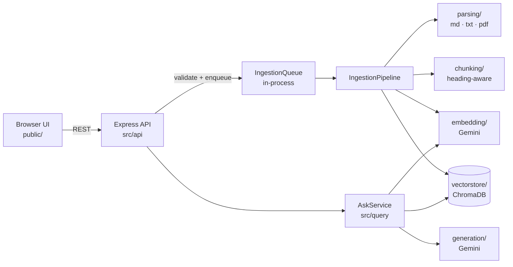
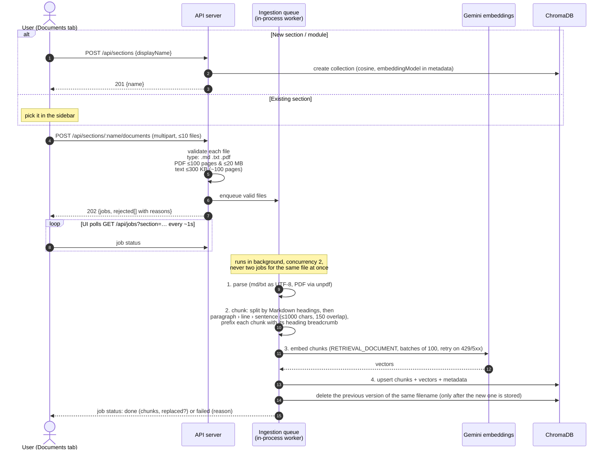
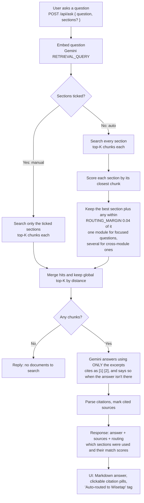

# RAG Generator (DocChat)

Upload documents into **sections** (modules/topics like "Wisetap" or "Payments") at runtime, then ask questions that are answered **only** from those documents, with citations. Adding a new document set means creating a section and uploading files, with no code changes.

## Quick start

```bash
npm install
cp .env.example .env       # then set GEMINI_API_KEY
npm run chroma:up          # ChromaDB on :8000 (Docker)
npm run dev                # API + UI on http://localhost:3000
```

Open http://localhost:3000:

- **Documents tab**: create a section, then drag files into it. Upload more files to an existing section at any time. Re-uploading a file with the same name replaces the old version.
- **Chat tab**: ask questions. Leave all sections unticked and the server **auto-routes** each question to the section that best matches it. Tick sections to search only those.

## Architecture



Each stage is an interface in its folder's `types.ts` (`DocumentParser`, `Chunker`, `Embedder`, `VectorStore`, `AnswerGenerator`, `IngestionQueue`), and `src/server.ts` wires the concrete implementations together. You can swap one (for example Chroma for pgvector, or the in-process queue for BullMQ) without touching the others.

**Data model:** one section is one Chroma collection (cosine distance). Each chunk stores `documentId`, `filename`, `heading` (breadcrumb such as `Wisetap > 3. Core Flows > (a) Event ingestion`), `index` and `uploadedAt`. The collection's metadata records which embedding model built it, so vectors from different models are never compared.

## Flow 1: Uploading documents (new or existing section)

Upload is **asynchronous**. The API validates the files, queues them, and returns `202` with job IDs straight away. A background worker in the same process then runs the pipeline, so long ingestions never block chat queries.



## Flow 2: Asking a question (chosen section or auto-routed)



**Why route on retrieval scores rather than an LLM classifier?** It adds no extra model call or latency, it needs no hand-written section descriptions, and it updates as soon as documents are added. Calibrated on the sample docs, single-module questions separate by at least 0.06 cosine distance between the best and second-best section, while cross-module questions land within about 0.01. The 0.04 margin sits between the two, and you can tune it with `ROUTING_MARGIN`.

## API

| Method | Path | Purpose |
| --- | --- | --- |
| GET | `/health` | server + Chroma status |
| GET | `/api/config` | upload limits, supported file types |
| GET | `/api/sections` | list sections with document/chunk counts |
| POST | `/api/sections` | `{ "displayName": "Payments" }` creates a section |
| DELETE | `/api/sections/:name` | delete a section and all its documents |
| GET | `/api/sections/:name/documents` | list documents in a section |
| POST | `/api/sections/:name/documents` | multipart `files` (≤10). Returns `202 { jobs, rejected }` |
| DELETE | `/api/sections/:name/documents/:documentId` | remove one document |
| GET | `/api/jobs?section=` | background ingestion job status |
| POST | `/api/ask` | `{ "question": "...", "sections": [] }` returns `{ answer, sources, routing }` (empty `sections` = auto-route) |

## Configuration (`.env`)

| Variable | Default | Notes |
| --- | --- | --- |
| `GEMINI_API_KEY` | (required) | used for embeddings and answers; `.env` is gitignored |
| `EMBEDDING_MODEL` | `gemini-embedding-001` | 3072-dim, supports retrieval task types |
| `GENERATION_MODEL` | `gemini-3.8-flash` | |
| `GENERATION_THINKING_LEVEL` | `LOW` | cut answer latency from ~3.9 s to ~1.4 s; empty = model default |
| `CHUNK_SIZE` / `CHUNK_OVERLAP` | `1000` / `150` | characters |
| `TOP_K` | `5` | chunks given to the LLM |
| `ROUTING_MARGIN` | `0.04` | auto-routing tolerance (cosine distance) |
| `MAX_PDF_PAGES` / `MAX_PDF_BYTES` | `100` / 20 MB | |
| `MAX_TEXT_BYTES` | 300 KB | about 100 pages of text |
| `MAX_FILES_PER_UPLOAD` | `10` | |
| `INGEST_CONCURRENCY` | `2` | background jobs running at once |

## Project layout

```
src/
  server.ts            composition root: builds and wires every component
  config.ts            env config, validated with zod at boot
  types.ts             shared shapes: ParsedDocument, Chunk, RetrievedChunk, Answer, Routing
  api/app.ts           HTTP routes, upload validation, error mapping
  parsing/             DocumentParser per file type (text.ts, pdf.ts) + registry
  chunking/            MarkdownChunker: heading-aware recursive splitter
  embedding/           Embedder → GeminiEmbedder
  vectorstore/         VectorStore → ChromaVectorStore
  generation/          AnswerGenerator → GeminiAnswerGenerator (grounding prompt)
  ingestion/           validate.ts (limits), pipeline.ts (parse→chunk→embed→store), queue.ts (background jobs)
  query/ask.ts         AskService: embed → route → retrieve → generate → cite
  retry.ts             backoff for transient Gemini errors
public/                UI (vanilla HTML/CSS/JS, no build step)
docs/                  FUTURE_IMPROVEMENTS.md
```

See [docs/FUTURE_IMPROVEMENTS.md](docs/FUTURE_IMPROVEMENTS.md) for known limitations and the scaling plan (durable queue, separate workers, and more).
