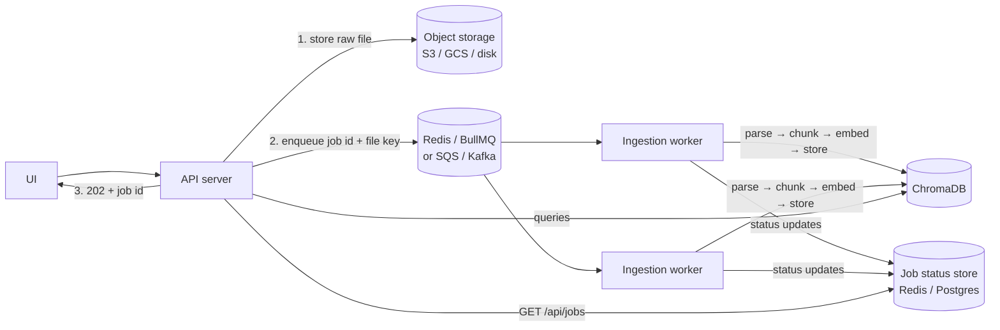

# Future Improvements

The current version deliberately keeps things simple. This doc records what we left out, why, and how to add it. Items are roughly in priority order within each area.

## 1. Durable queue + separate ingestion workers (top priority for scale)

**Today:** `InProcessQueue` (`src/ingestion/queue.ts`) runs ingestion jobs in the background **inside the API process**: upload returns `202` and a worker loop runs parse → chunk → embed → store with concurrency 2. Queries stay responsive because ingestion is mostly network I/O (Gemini, Chroma).

**Limitations:**
- Jobs and their file buffers live in memory, so a restart loses queued jobs and their status.
- CPU-heavy parsing (large PDFs) shares the event loop with queries.
- It can't scale horizontally: each API replica has its own queue.

**Target design:**

- Implement `IngestionQueue` with BullMQ (Redis): `enqueue` writes the file to object storage and adds a job. `list` reads job state from Redis.
- Run workers as a separate entry point (`src/worker.ts`) that reuses `IngestionPipeline` unchanged.
- Keep the same-file serialization rule (today's `active` set): use a BullMQ group or job-ID dedup keyed by `section/filename`.
- Add retries with backoff at the job level, a dead-letter queue for poison files, and per-tenant rate limiting for Gemini quota.

## 2. Retrieval quality

- **Conversation-aware follow-ups:** each question is currently retrieved on its own, so "what about its scale?" loses its subject. Rewrite the follow-up into a standalone question with a cheap LLM call before embedding, and pass the recent turns to the generator.
- **Hybrid search:** add BM25/keyword matching alongside vectors (Chroma supports full-text and sparse indexes) so exact identifiers like `journey_trigger_firings` or error codes match reliably.
- **Re-ranking:** retrieve about 20 candidates, then re-rank them with a cross-encoder or an LLM, and keep the top 5.
- **Relevance floor:** drop chunks above a distance threshold so off-topic questions return no sources instead of 5 weak ones.
- **Smarter routing:** routing currently uses each section's single closest chunk with a fixed margin (calibrated on the sample docs). Options: average the top-3 distances, learn the margin per corpus, or fall back to an LLM router that uses auto-generated section summaries when scores are ambiguous.
- **Retrieval as a tool (agentic RAG):** expose `search(section, query)` to the model via function calling. It could then choose sections itself, search several times for multi-part questions, and ask for clarification.
- **Table / code-aware chunking:** keep Markdown tables and fenced code blocks intact, and repeat table headers when a table must be split.

## 3. Ingestion

- **More formats:** `.docx` (mammoth), `.html`, `.csv`. Add a `DocumentParser` and register it in `src/parsing/index.ts`.
- **Scanned PDFs:** OCR fallback when a PDF has no extractable text (currently fails with a clear message).
- **Content-hash dedup:** skip re-embedding when an identical file is re-uploaded.
- **Section metadata:** a description for each section, shown in the UI and usable by an LLM router.
- **Re-embedding job:** when `EMBEDDING_MODEL` changes, old sections are marked incompatible and excluded from search. Add a one-click "re-index section" job, which requires storing the original files (see 1).

## 4. Platform

- **Auth and multi-tenancy:** API keys or SSO, with sections scoped per team.
- **Streaming answers** (SSE) for faster perceived latency.
- **Observability:** structured logs (pino), request IDs, metrics for ingestion duration, Gemini latency/errors and retrieval distances. Also an evaluation set of question → expected-source pairs to catch retrieval regressions when chunking or models change.
- **Tests:** unit tests for the chunker, citation parsing and routing. Integration tests against a throwaway Chroma container with a stubbed embedder.
- **Pagination** for `listDocuments` (currently loads all chunk metadata, which is fine for thousands of chunks but not millions). Keep a lightweight document manifest instead.
- **Limits:** the per-file caps (100 PDF pages, 300 KB text, 10 files per upload) are deliberately conservative. Raise them once ingestion runs on dedicated workers.
